# Visual Training Storyboard

Reference style documentation extracted exclusively from `visual-direction-draft.md` and the 20 reference frames in `storyboard-frames/video1/` and `storyboard-frames/video2/`.

> **Scope & Style Rules**:
> - Reusable editing and motion design style for vertical 9:16 videos.
> - Reference words, numbers, products, and graphics shown in these frames are examples of the style only and must not be copied into unrelated videos.
> - Data and values documented below are taken strictly from the actual frames and visual direction draft; unconfirmed values remain marked unknown.

---

# Part 1: Reference Video 1 (1080x1920, 30fps)

---

### Frame 01: Hook Talking Head & Structure Preview Pill

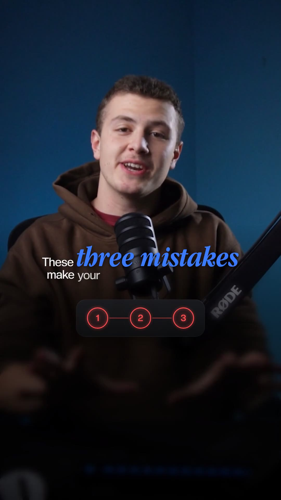

- **Timestamp & New Editing Style**:
  - **Timestamp**: Unknown (Hook scene; introduces the first seconds of video per MD Section 1).
  - **New Editing Style Introduced First**: Main speaker talking head with lower-third dark glass numbered pill preview and talking caption featuring large script same-family gradient highlight.
- **Layout Type**: Full Speaker.
- **Content Type, Main Focus & Caption Mode**:
  - **Content Type**: Person Centric (Person in Center / Talking Head Hook).
  - **Main Focus**: Main speaker stating core hook problem ("three mistakes") with road-map pill preview.
  - **Caption Mode**: Mode A: Talking Caption (lower thirds, over speaker chest area, never over face).
- **UI Card or Graph Type & Actual Values**:
  - **UI Card Type**: Dark glass pill card, horizontal layout, soft drop shadow.
  - **Actual Values**: Three red circular outline nodes labeled `(1)`, `(2)`, and `(3)` connected by a thin red horizontal line.
- **Two-Layer & Eye-Line Crop Check**: N/A (Full Speaker layout; speaker occupies full frame).
- **Brief Sound Cue**: Pop or click on appearance of dark glass pill card; riser building into the hook claim; music kept low under voice.
- **Numbered Legend**:
  1. **Main speaker**: Head-and-shoulders, centred horizontally against dark blue backdrop with RØDE microphone visible at centre.
  2. **Blurred and darkened lower third**: Speaker chest area darkened and blurred to ensure high contrast behind text and UI.
  3. **Script key word highlight**: "three mistakes" in large bright blue script italic with subtle same-family gradient and soft blue glow, centre left.
  4. **Primary sans caption**: "These" (top left) and "make your" (bottom left) in `#F3F3F3` off-white sans font (`Creato Display`) with light drop shadow.
  5. **Dark glass preview container**: Translucent rounded pill card anchored at lower thirds / chest level, bottom centre.
  6. **Step indicator circles**: Three red circular outline nodes containing red numbers `1`, `2`, and `3` joined by a red horizontal rule, bottom centre.

---

### Frame 02: Progression Slider UI Card

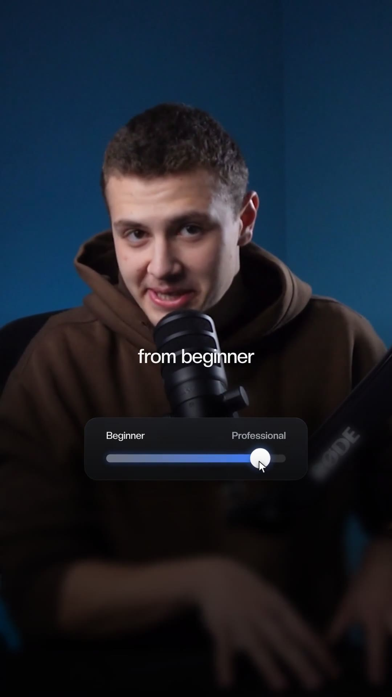

- **Timestamp & New Editing Style**:
  - **Timestamp**: Unknown (Hook structure preview continuation).
  - **New Editing Style Introduced First**: Interactive horizontal slider UI card with filled blue gradient progress track, circular control knob, and mouse cursor pointer.
- **Layout Type**: Full Speaker (with slow steady push-in / forward lean).
- **Content Type, Main Focus & Caption Mode**:
  - **Content Type**: Person Centric (Person in Center) / Supporting UI Slider.
  - **Main Focus**: Visualizing progression levels ("Beginner" to "Professional") via an interactive slider.
  - **Caption Mode**: Mode A: Talking Caption (lower thirds, chest level).
- **UI Card or Graph Type & Actual Values**:
  - **UI Card Type**: Dark glass rounded rectangular card with slider bar graph.
  - **Actual Values**: Left text label: `Beginner`; Right text label: `Professional`; horizontal slider track with filled blue gradient bar extending ~85% towards right; solid white circular thumb; white mouse cursor arrow clicking on thumb.
- **Two-Layer & Eye-Line Crop Check**: N/A (Full Speaker layout).
- **Brief Sound Cue**: Whoosh on slider thumb motion; click sound on cursor arrival at thumb; music low under voice.
- **Numbered Legend**:
  1. **Main speaker**: Talking head with continuous slow push-in, centred, RØDE microphone visible.
  2. **Darkened chest background**: Chest and hoodie blurred and darkened behind card container.
  3. **Talking caption**: "from beginner" in off-white sans font (`#F3F3F3`), positioned lower thirds above card.
  4. **Dark glass card frame**: Translucent dark rounded rectangle floating below microphone, bottom centre.
  5. **Progress labels**: "Beginner" (left) and "Professional" (right) in small white sans text inside card.
  6. **Filled blue slider track**: Horizontal bar with blue gradient fill progressing left to right, inside card.
  7. **Slider thumb and cursor**: White circular knob with white pointer cursor icon positioned near "Professional", bottom right of card.

---

### Frame 03: Chapter Active Tracking & Word-by-Word Blur Pop

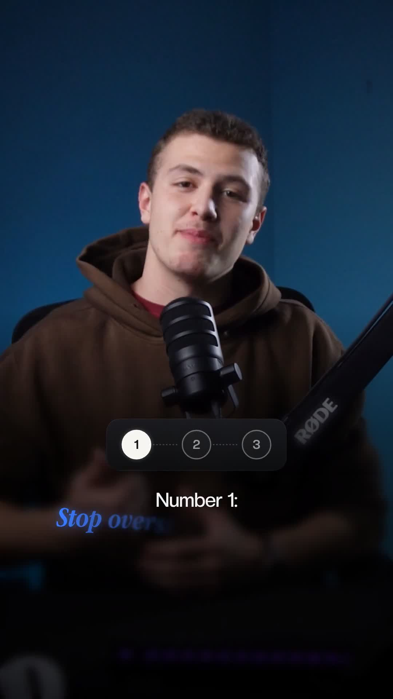

- **Timestamp & New Editing Style**:
  - **Timestamp**: Unknown (Chapter 1 transition).
  - **New Editing Style Introduced First**: Active chapter tracking pill (Step 1 solid filled, subsequent steps hollow with dashed line) and word-by-word rising/fading text entry with motion blur (<1.5s duration).
- **Layout Type**: Full Speaker.
- **Content Type, Main Focus & Caption Mode**:
  - **Content Type**: Person Centric (Person in Center) / Chapter Structure Tracker.
  - **Main Focus**: Transitioning into Chapter 1 with synchronized UI state change.
  - **Caption Mode**: Mode A: Talking Caption (lower thirds / chest).
- **UI Card or Graph Type & Actual Values**:
  - **UI Card Type**: Dark glass pill card with 3 chapter steps.
  - **Actual Values**: Node `1` filled solid white with black numeral `1`; Node `2` hollow grey ring with grey numeral `2`; Node `3` hollow grey ring with grey numeral `3`; connecting lines are dashed grey lines.
- **Two-Layer & Eye-Line Crop Check**: N/A (Full Speaker layout).
- **Brief Sound Cue**: Click/pop on Node 1 turning solid white; hit on "Number 1" key point; music low under voice.
- **Numbered Legend**:
  1. **Main speaker**: Talking head centred, RØDE microphone in lower-centre foreground.
  2. **Chapter tracking pill**: Dark translucent pill card floating at upper chest level, mid-frame.
  3. **Active step node**: Solid white filled circle with black digit `1` denoting Chapter 1 active, inside pill left.
  4. **Inactive step nodes**: Hollow grey outline circles `2` and `3` connected by a dashed grey line, inside pill right.
  5. **Section title caption**: "Number 1:" in clean off-white sans font, positioned below chapter pill, centre.
  6. **Script key word**: "Stop" in large bright blue script italic with soft blue glow, lower left.
  7. **Motion blur word pop**: "over" in transitioning blur and fade state demonstrating word-by-word rise under 1.5s, lower centre.

---

### Frame 04: Tilted Mockup Card & Isolated Statement on Full Canvas

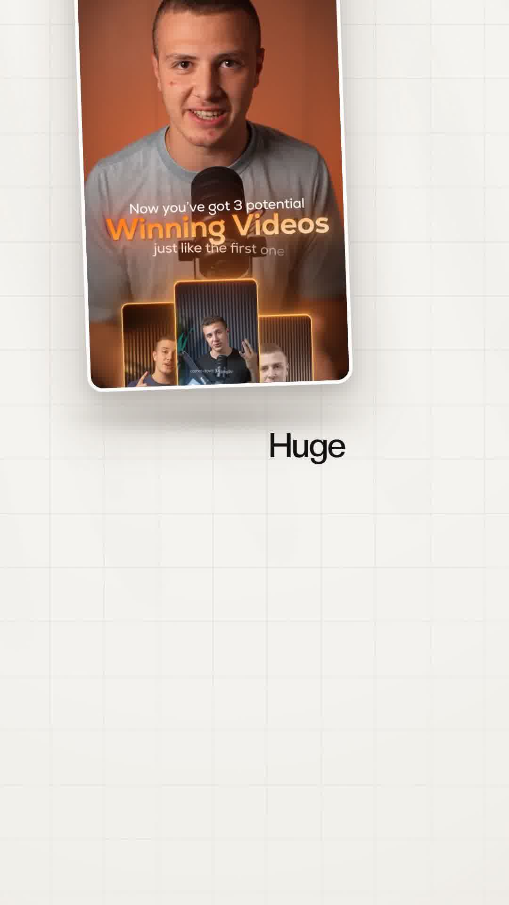

- **Timestamp & New Editing Style**:
  - **Timestamp**: Unknown.
  - **New Editing Style Introduced First**: 100% Full Canvas on warm off-white grid background, tilted B-roll video mockup card with nested UI cards, and isolated statement word.
- **Layout Type**: 100% Full Canvas.
- **Content Type, Main Focus & Caption Mode**:
  - **Content Type**: Object Centric (Object (Middle) + Text) / B-roll Inside Card.
  - **Main Focus**: Tilted vertical smartphone/video mockup card showing multi-video output.
  - **Caption Mode**: Mode B: Statement Lockup (single curated word with generous empty space).
- **UI Card or Graph Type & Actual Values**:
  - **UI Card Type**: Tilted vertical card with white rounded border and soft cast drop shadow.
  - **Actual Values**: Inside card: talking head in light grey t-shirt; overlaid caption text: `Now you've got 3 potential Winning Videos just like the first one` ("Winning Videos" in large orange script/sans highlight); three nested vertical sub-cards at bottom with glowing orange borders displaying video thumbnails.
- **Two-Layer & Eye-Line Crop Check**: N/A (100% Full Canvas; no speaker present on screen).
- **Brief Sound Cue**: Whoosh on tilted card entry; pop on card settling onto canvas; music low under voice.
- **Numbered Legend**:
  1. **Warm off-white grid canvas**: Full-screen warm off-white background with thin light-grey grid lines and soft cast shadow overlay.
  2. **Tilted B-roll mockup card**: White-bordered vertical video card rotated ~3 degrees clockwise with soft drop shadow, upper centre.
  3. **Mockup internal speaker**: Subject inside B-roll card wearing light grey shirt against orange studio background.
  4. **Internal nested thumbnail cards**: Three small vertical cards with orange illuminated border strokes along bottom of tilted card.
  5. **Internal card caption**: "Now you've got 3 potential Winning Videos just like the first one" inside tilted card.
  6. **Focal statement caption**: "Huge" in bold black sans font (`Creato Display`), floating with generous empty space below card, centre.

---

### Frame 05: 50/50 Split Layout & Glossy Play Card

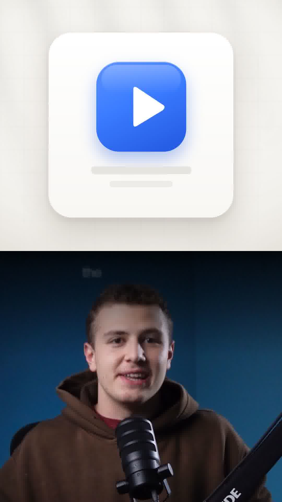

- **Timestamp & New Editing Style**:
  - **Timestamp**: Unknown.
  - **New Editing Style Introduced First**: 50/50 Split layout establishing two strict layers (Layer A top graphic canvas, Layer B bottom clean person strip) and glossy white app play-card.
- **Layout Type**: 50/50 Split.
- **Content Type, Main Focus & Caption Mode**:
  - **Content Type**: Person Centric (Person on Side / Split) & Object Centric (Object in Graphic Layer).
  - **Main Focus**: Glossy play button UI card displayed on graphic layer while speaker explains in bottom layer.
  - **Caption Mode**: Mode A: Talking Caption (transitional / clean frame prior to caption pop).
- **UI Card or Graph Type & Actual Values**:
  - **UI Card Type**: Glossy rounded squircle white card with soft drop shadow.
  - **Actual Values**: Central glossy bright blue rounded square with solid white play triangle; two rounded horizontal light-grey skeleton placeholder bars below it.
- **Two-Layer & Eye-Line Crop Check**:
  - **Layer A (Top Graphic Layer, 0%–50% Height)**: Warm off-white background with thin grey grid and cast shadow overlay. Glossy play card centered in Layer A. Holds all cards and graphic elements.
  - **Layer B (Bottom Person Layer, 50%–100% Height)**: Clean person layer only. Speaker in brown hoodie with RØDE mic. Zero text, zero cards, zero badges, zero overlays on this layer.
  - **Split Boundary**: Clean horizontal division exactly at 50% frame height; no heavy divider line.
  - **Eye-Line Crop Check**:
    - Head top: ~53% from final frame top (~3% headroom below split line).
    - Eye line: ~64% from final frame top (strictly inside the required 62%–65% target band).
    - Chin: ~73% from final frame top (fully visible, well above shoulders).
    - Person strip was cropped from eye line with small headroom (~5% of strip) and shoulders/mic preserved, NOT taken as the raw bottom 50% of the talking-head frame.
- **Brief Sound Cue**: Whoosh on 50/50 split transition; pop on glossy card appearance; music low under voice.
- **Numbered Legend**:
  1. **Graphic layer canvas (Layer A)**: Warm off-white background with thin grey grid and soft cast shadow, occupying top 0%–50%.
  2. **Glossy white card container**: Rounded square white container with soft drop shadow centered in Layer A.
  3. **Play button icon**: Glossy bright blue squircle containing a solid white play triangle, inside white card.
  4. **Skeleton loading bars**: Two rounded horizontal light-grey placeholder bars beneath play icon, inside white card.
  5. **Split line**: Clean horizontal 50% split boundary without heavy divider stroke.
  6. **Clean person layer (Layer B)**: Speaker head, shoulders, and microphone occupying bottom 50%–100%, completely clean.
  7. **Calibrated eye line**: Speaker eyes aligned at ~64% frame height, maintaining eye-line consistency.

---

### Frame 06: Snap Scale Animation, Dashed Boundary & Percentage Badge

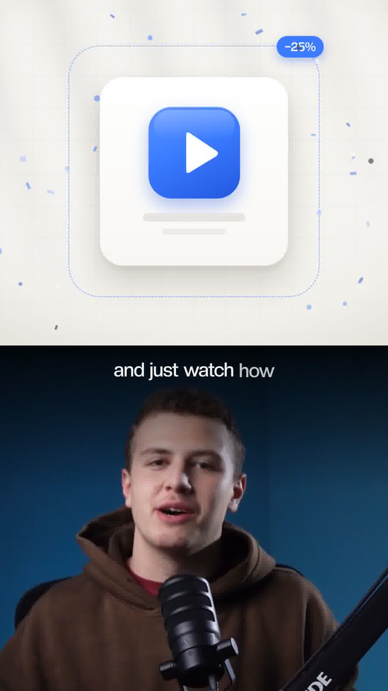

- **Timestamp & New Editing Style**:
  - **Timestamp**: Unknown.
  - **New Editing Style Introduced First**: Snap scale animation (graphic snaps from 100% to ~75%), dashed outline bounding box with percentage badge (`-25%`), particle bursts, and split clearance caption placement.
- **Layout Type**: 50/50 Split.
- **Content Type, Main Focus & Caption Mode**:
  - **Content Type**: Graphic Centric / Object Centric with Snap Scale & Badge.
  - **Main Focus**: Downsized play card highlighting numerical reduction metric (`-25%`).
  - **Caption Mode**: Mode A: Talking Caption.
    - Actual Caption Words: `and just watch how` in `#F3F3F3` off-white sans font. Positioned in clearance space at bottom of graphic layer above head.
- **UI Card or Graph Type & Actual Values**:
  - **UI Card Type**: Downscaled white play card with dashed bounding box, corner badge, and floating confetti flecks.
  - **Actual Values**: White card scaled down to ~75%; surrounding thin blue dashed rounded rectangle; blue pill badge in upper-right corner with text `-25%`; scattered small blue rectangular and square confetti flecks on grid canvas.
- **Two-Layer & Eye-Line Crop Check**:
  - **Layer A (Top Graphic Layer, 0%–50% Height)**: Warm off-white grid canvas holding shrunk card, dashed border, `-25%` badge, floating confetti, and caption `and just watch how` placed at the bottom of Layer A above speaker's head.
  - **Layer B (Bottom Person Layer, 50%–100% Height)**: Clean person layer only. Speaker with mic, zero text or cards over face.
  - **Eye-Line Crop Check**:
    - Head top: ~54% frame height (clean headroom below split).
    - Eye line: ~64% frame height (strictly in 62%–65% band).
    - Chin: ~73% frame height (fully visible).
    - Cropped from eye line with correct headroom and shoulders visible.
- **Brief Sound Cue**: Pop/snap on card scale reduction to 75%; click on `-25%` badge reveal; subtle whoosh; music low under voice.
- **Numbered Legend**:
  1. **Shrunk UI card**: White play button card scaled down to ~75% to make room for bounding box and metrics, centre of Layer A.
  2. **Dashed bounding frame**: Thin blue dashed line surrounding the card indicating reduced boundary, Layer A.
  3. **Metric badge**: Solid bright blue pill with white text "-25%" anchored to the top-right corner of the dashed boundary, top right.
  4. **Ambient particle flecks**: Small blue confetti squares and rectangles scattered on the warm grid canvas for visual depth.
  5. **Split talking caption**: "and just watch how" in off-white sans font, resting in the clearance zone between graphic and head, centre.
  6. **Split line**: Clean 50% horizontal division between top graphic canvas and bottom speaker video.
  7. **Clean person layer (Layer B)**: Main speaker with microphone, eye line maintained at ~64%, zero overlay on face.

---

### Frame 07: Segmented Loading Bar Card & Header Metadata Counter

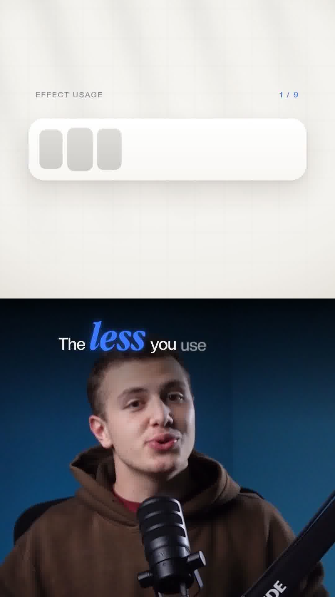

- **Timestamp & New Editing Style**:
  - **Timestamp**: Unknown.
  - **New Editing Style Introduced First**: Horizontal segmented progress bar card with uppercase header metadata and ratio counter (`EFFECT USAGE`, `1 / 9`), paired with script gradient talking caption.
- **Layout Type**: 50/50 Split.
- **Content Type, Main Focus & Caption Mode**:
  - **Content Type**: Graphic Centric / UI Graph Card (Loading Bar) + Person Centric.
  - **Main Focus**: Quantified progress card illustrating minimal effect usage ratio (`1 / 9`).
  - **Caption Mode**: Mode A: Talking Caption.
    - Actual Caption Words: `The less you use` ("The" and "you use" in white sans; "less" in large bright blue script italic with blue glow). Positioned in clearance space above head.
- **UI Card or Graph Type & Actual Values**:
  - **UI Card Type**: Rounded horizontal progress card with metadata header.
  - **Actual Values**: Left header label: `EFFECT USAGE` (small grey uppercase sans); Right header counter: `1 / 9` (small blue sans); rounded white horizontal card containing 3 visible light-grey rounded vertical blocks/segments (remainder of track empty/white).
- **Two-Layer & Eye-Line Crop Check**:
  - **Layer A (Top Graphic Layer, 0%–50% Height)**: Warm off-white grid canvas holding header text, segmented card, and talking caption in clearance space.
  - **Layer B (Bottom Person Layer, 50%–100% Height)**: Clean person layer only. Speaker head, shoulders, and mic. Face and eyes unobstructed.
  - **Eye-Line Crop Check**:
    - Head top: ~54% frame height (headroom below split line).
    - Eye line: ~64% frame height (inside 62%–65% band).
    - Chin: ~73% frame height (fully visible).
    - Person strip cropped from eyes, keeping shoulders and mic intact.
- **Brief Sound Cue**: Pop on segment fill; click on `1 / 9` counter appearance; hit on key word "less"; music low under voice.
- **Numbered Legend**:
  1. **Section header label**: "EFFECT USAGE" in uppercase muted grey sans text, top-left of graphic canvas.
  2. **Numeric ratio counter**: "1 / 9" in accent blue sans text, top-right of graphic canvas.
  3. **Segmented card container**: Rounded white horizontal card resting on the warm grid background, upper centre.
  4. **Loading bar segments**: Three rounded vertical grey blocks representing effect increments inside card, upper centre.
  5. **Script key word**: "less" in large bright blue script italic with same-family gradient and soft glow, mid-frame clearance zone.
  6. **Normal caption words**: "The" (left) and "you use" (right) in flat off-white sans font flanking the script word.
  7. **Clean person layer**: Speaker positioned in Layer B with eye line at ~64%, shoulders filling lower third, microphone visible.

---

### Frame 08: 3D Central Object with Edit Timeline & Sound Wave Cards

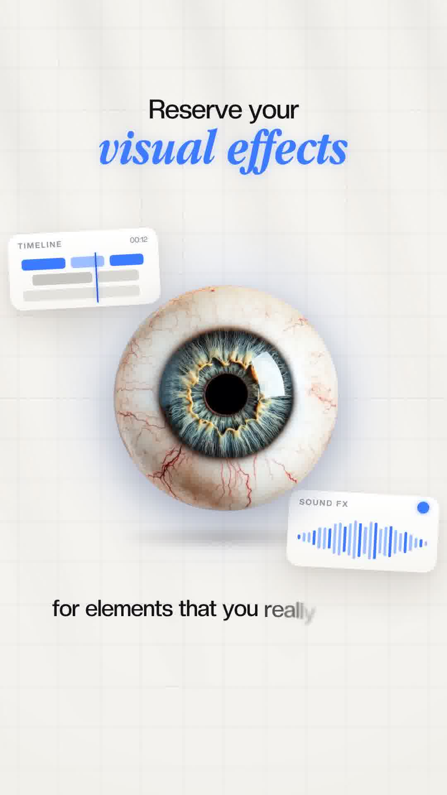

- **Timestamp & New Editing Style**:
  - **Timestamp**: Unknown [Internal UI timecode: `00:12`].
  - **New Editing Style Introduced First**: 100% Full Canvas with photorealistic 3D central focal object (eyeball), floating timeline track card, and audio waveform sound card.
- **Layout Type**: 100% Full Canvas.
- **Content Type, Main Focus & Caption Mode**:
  - **Content Type**: Object Centric (Object + Graphic / Documentary 3D Inspiration).
  - **Main Focus**: Photorealistic 3D human eyeball as centre focal point with supporting timeline and sound FX cards.
  - **Caption Mode**: Mode B: Statement Lockup (top statement lockup + secondary bottom supporting line).
    - Actual Headline Words: `Reserve your visual effects` ("Reserve your" in black sans, "visual effects" in large blue script italic with soft blue glow).
    - Actual Bottom Words: `for elements that you really` (dark sans, "really" blurred in motion).
- **UI Card or Graph Type & Actual Values**:
  - **Card 1 (Top-Left)**: Rounded white timeline card labeled `TIMELINE` (left) and `00:12` (right); displays blue and grey horizontal video/audio track clips with a vertical blue playhead line cutting through them.
  - **Card 2 (Bottom-Right)**: Rounded white sound FX card labeled `SOUND FX` with a solid blue circle dot indicator (top right); displays a vertical blue audio waveform bar chart.
- **Two-Layer & Eye-Line Crop Check**: N/A (100% Full Canvas layout; no speaker present).
- **Brief Sound Cue**: Low sub-bass hit on 3D eyeball reveal; riser before reveal; click on timeline card; whoosh on sound FX card pop; music low under voice.
- **Numbered Legend**:
  1. **Top headline lockup**: "Reserve your" in black sans paired with "visual effects" in large blue script italic with soft blue glow, top centre.
  2. **Timeline UI card**: Floating white rounded card labeled "TIMELINE" and "00:12", with blue/grey tracks and playhead line, upper left.
  3. **Photorealistic 3D eyeball**: Highly detailed human eyeball with blue-green iris and detailed sclera blood vessels, casting soft shadow on grid, dead centre.
  4. **Sound FX card**: Floating white rounded card labeled "SOUND FX" with blue status dot and blue audio waveform bars, lower right.
  5. **Grid canvas**: Warm off-white background with subtle thin grey grid lines and soft organic cast shadow.
  6. **Secondary caption line**: "for elements that you really" in dark sans text with "really" blurred in motion, bottom centre.

---

### Frame 09: Multi-Card Orbital Layout (7 Brand Logo Cards)

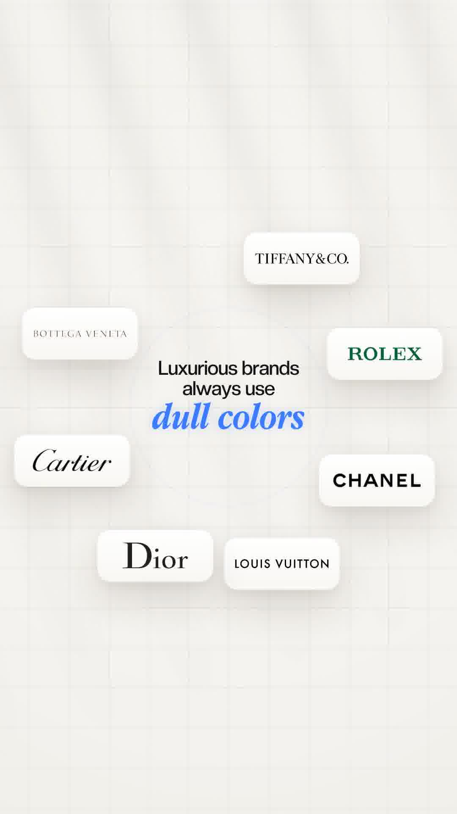

- **Timestamp & New Editing Style**:
  - **Timestamp**: Unknown.
  - **New Editing Style Introduced First**: Multi-card orbital layout (7 floating white brand logo cards arranged around a central statement lockup) on 100% Full Canvas.
- **Layout Type**: 100% Full Canvas.
- **Content Type, Main Focus & Caption Mode**:
  - **Content Type**: Text Centric (Text + Graphic / Object) / Orbiting Brand Cards.
  - **Main Focus**: Central typography statement about luxury brand aesthetics surrounded by luxury logo cards.
  - **Caption Mode**: Mode B: Statement Lockup.
    - Actual Words: `Luxurious brands always use dull colors` ("Luxurious brands" and "always use" in black sans font; "dull colors" in large bright blue script italic with blue glow and subtle gradient).
- **UI Card or Graph Type & Actual Values**:
  - **UI Card Type**: 7 rounded rectangular white glossy cards with branded logos orbiting the center.
  - **Actual Values**:
    1. Top-Right: `TIFFANY&CO.` in black serif.
    2. Mid-Right: `ROLEX` in forest green all-caps serif.
    3. Lower-Right: `CHANEL` in bold black sans.
    4. Bottom-Center: `LOUIS VUITTON` in black sans.
    5. Bottom-Left: `Dior` in black serif.
    6. Mid-Left: `Cartier` in black cursive script.
    7. Upper-Left: `BOTTEGA VENETA` in dark grey all-caps sans.
- **Two-Layer & Eye-Line Crop Check**: N/A (100% Full Canvas layout).
- **Brief Sound Cue**: Pop/click on each logo card appearance in rapid succession; whoosh on orbital arrival; music low under voice.
- **Numbered Legend**:
  1. **Central statement lockup**: "Luxurious brands always use" in clean black sans above "dull colors" in large blue script italic, dead centre.
  2. **"TIFFANY&CO." card**: White rounded card with black serif typography, upper right.
  3. **"ROLEX" card**: White rounded card with green serif logotype, middle right.
  4. **"CHANEL" card**: White rounded card with bold black sans-serif logotype, lower right.
  5. **"LOUIS VUITTON" card**: White rounded card with black sans-serif typography, bottom centre.
  6. **"Dior" card**: White rounded card with classic black serif logotype, lower left.
  7. **"Cartier" card**: White rounded card with iconic cursive black logotype, middle left.
  8. **"BOTTEGA VENETA" card**: White rounded card with clean sans-serif typography, upper left.
  9. **Minimal canvas background**: Warm off-white canvas with thin grey grid and soft cast shadow, full frame.

---

### Frame 10: Completed Chapter Recap Pill on Full Speaker

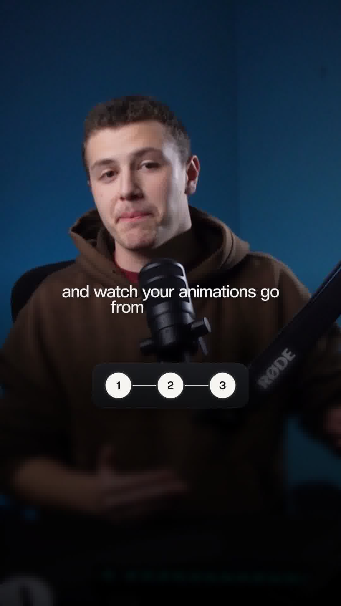

- **Timestamp & New Editing Style**:
  - **Timestamp**: Unknown (Recap / Ending phase per MD Section 4 line 240).
  - **New Editing Style Introduced First**: Fully completed chapter recap pill (all 3 numbered steps filled solid white with solid white connecting lines) on Full Speaker.
- **Layout Type**: Full Speaker.
- **Content Type, Main Focus & Caption Mode**:
  - **Content Type**: Person Centric (Person in Center / Recap).
  - **Main Focus**: Speaker delivering recap of the three covered principles.
  - **Caption Mode**: Mode A: Talking Caption.
    - Actual Words: `and watch your animations go from` in off-white sans font (`#F3F3F3`), lower thirds over chest.
- **UI Card or Graph Type & Actual Values**:
  - **UI Card Type**: Dark glass pill card with 3 completed chapters.
  - **Actual Values**: Nodes `1`, `2`, and `3` are all filled solid white with black numerals `1`, `2`, `3`; connecting lines between all three nodes are solid white.
- **Two-Layer & Eye-Line Crop Check**: N/A (Full Speaker layout).
- **Brief Sound Cue**: Hit on completion recap; click on third node fill; music low under voice.
- **Numbered Legend**:
  1. **Main speaker**: Talking head centred with dark blue background, shoulders and RØDE microphone at bottom.
  2. **Blurred/darkened chest area**: Background blurred and darkened behind text and card for enhanced readability.
  3. **Talking caption**: "and watch your animations go from" in clean off-white sans (`#F3F3F3`), lower thirds.
  4. **Completed recap pill**: Dark translucent pill container positioned below microphone, bottom centre.
  5. **Completed step nodes**: Three solid white circular badges displaying black numbers `1`, `2`, and `3`, bottom centre.
  6. **Solid connection lines**: White continuous lines connecting nodes 1-to-2 and 2-to-3 denoting full sequence completion.

---

# Part 2: Reference Video 2 (720x1280, 30fps)

---

### Frame 01: Split Statement with Highlight Badge & Terminal Code Card

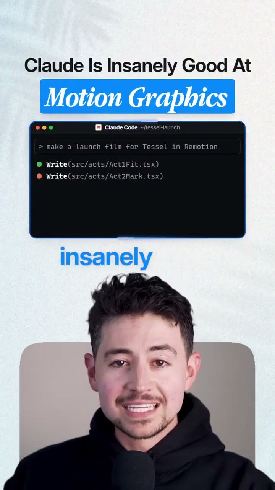

- **Timestamp & New Editing Style**:
  - **Timestamp**: Unknown (Hook scene; starts at 0s / first seconds per MD Section 1).
  - **New Editing Style Introduced First**: 50/50 Split featuring a headline statement with vibrant blue script badge card, terminal code window mockup, and cyan talking caption.
- **Layout Type**: 50/50 Split.
- **Content Type, Main Focus & Caption Mode**:
  - **Content Type**: Text + Object / Graphic Centric + Person Centric.
  - **Main Focus**: Terminal code execution prompt paired with bold headline claim above speaker.
  - **Caption Mode**: Mode A: Talking Caption (isolated key word in clearance gap).
    - Actual Headline Words: `Claude Is Insanely Good At` (black sans bold) / `Motion Graphics` (white script italic inside solid blue card).
    - Actual Talking Caption Word: `insanely` in bright cyan-blue bold sans. Positioned in clearance gap directly above speaker's head.
- **UI Card or Graph Type & Actual Values**:
  - **UI Card 1**: Solid bright blue rounded rectangular card containing white script text `Motion Graphics`.
  - **UI Card 2**: Dark terminal window mockup with macOS red, yellow, green control dots, window title `Claude Code ~/tessel-launch`.
  - **Actual Values inside Terminal**:
    ```text
    > make a launch film for Tessel in Remotion
    ● Write(src/acts/Act1Fit.tsx) [green dot]
    ● Write(src/acts/Act2Mark.tsx) [orange dot]
    ```
- **Two-Layer & Eye-Line Crop Check**:
  - **Layer A (Top Graphic Layer, 0%–50% Height)**: Pale textured paper/canvas background holding headline, blue script badge, terminal window, and cyan word `insanely` at the bottom of Layer A.
  - **Layer B (Bottom Person Layer, 50%–100% Height)**: Clean person layer only. Rounded speaker container, person with dark hoodie and mic. Face and eyes clean.
  - **Eye-Line Crop Check**:
    - Head top: ~55% frame height (below split line).
    - Eye line: ~64% frame height (strictly in 62%–65% band).
    - Chin: ~73% frame height (fully visible).
    - Person strip cropped from eye line with small headroom, NOT taken as bottom 50% talking head.
- **Brief Sound Cue**: Whoosh on split entry; click on code window spawn; riser before headline reveal; music low under voice.
- **Numbered Legend**:
  1. **Top statement headline**: "Claude Is Insanely Good At" in bold black sans-serif font, top centre.
  2. **Highlight badge card**: Bright blue rounded rectangle containing "Motion Graphics" in white script italic, top centre.
  3. **Terminal window mockup**: Dark macOS terminal window with red, yellow, green window dots and title "Claude Code ~/tessel-launch", mid Layer A.
  4. **Code execution prompt**: Monospace text `> make a launch film for Tessel in Remotion` with green and orange bullet status points, inside terminal.
  5. **Talking caption word**: "insanely" in vibrant cyan-blue bold sans font, positioned in the gap above speaker's head, centre.
  6. **Split line boundary**: Clean transition between upper canvas and lower rounded speaker container at 50%.
  7. **Clean speaker layer (Layer B)**: Speaker with microphone, eye line calibrated at ~64%, zero text over face or chin.

---

### Frame 02: Full Browser Multi-Track Timeline & Audio Decibel Meters

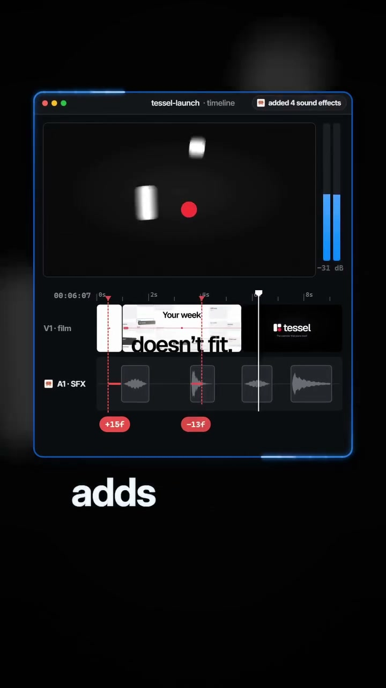

- **Timestamp & New Editing Style**:
  - **Timestamp**: Unknown [Internal timeline timecode: `00:06:07`, playhead at ~5.5s].
  - **New Editing Style Introduced First**: 100% Full Canvas dark mode with glowing blue border window mockup, video motion preview, dual audio decibel meters, multi-track timeline, and frame offset delta badges.
- **Layout Type**: 100% Full Canvas.
- **Content Type, Main Focus & Caption Mode**:
  - **Content Type**: Object Centric (Browser Window Mockup + Timeline Card).
  - **Main Focus**: Detailed multi-track video and sound effects timeline editor window.
  - **Caption Mode**: Mode B: Statement Lockup / Bottom Focal Word.
    - Actual Caption Word: `adds` in large white bold sans font (`Creato Display`), bottom centre.
- **UI Card or Graph Type & Actual Values**:
  - **UI Card Type**: Dark macOS browser/app window mockup with glowing blue outer border stroke.
  - **Actual Values**:
    - Window header: Red, yellow, green dots; title: `tessel-launch · timeline`; right pill badge: `added 4 sound effects`.
    - Motion preview canvas: Dark display with bouncing white capsules and central red circular dot.
    - Decibel meters: Dual vertical blue VU level bars reading `-31 dB` on right side.
    - Timeline ruler: Timecode `00:06:07`, ruler marks `0s`, `2s`, `4s`, `8s`, white playhead cursor at ~5.5s.
    - Video track: `V1 · film` with thumbnails (`Your week doesn't fit.`, `tessel`).
    - Red markers & badges: Red dashed vertical marker at 1s with red badge `+15f`; second red dashed marker at ~4.5s with red badge `-13f`.
    - Audio track: `A1 · SFX` with four distinct waveform sound blocks.
- **Two-Layer & Eye-Line Crop Check**: N/A (100% Full Canvas layout; no speaker present).
- **Brief Sound Cue**: Pop on window pop-in; whoosh on playhead movement; click on sound effect block; music low under voice.
- **Numbered Legend**:
  1. **Dark canvas background**: Deep dark charcoal/black full-screen canvas.
  2. **Glowing app window**: Dark macOS application window with glowing blue perimeter outline and window control dots, centre.
  3. **Window badge pill**: Rounded dark pill in top-right window bar reading "added 4 sound effects".
  4. **Video preview canvas**: Dark display area showing motion graphic pills, red dot, and vertical blue audio VU meters at "-31 dB", upper window.
  5. **Multi-track timeline**: Ruler marked with "00:06:07", track "V1 · film" with preview frames, and track "A1 · SFX" with 4 sound waveforms, lower window.
  6. **Frame offset badges**: Red indicator flags displaying exact timing adjustments "+15f" and "-13f" along timeline playhead, lower window.
  7. **Supporting word caption**: "adds" in heavy bold white sans font, positioned below window with generous margin, bottom centre.

---

### Frame 03: Split Timeline with Stacked Tool Badges

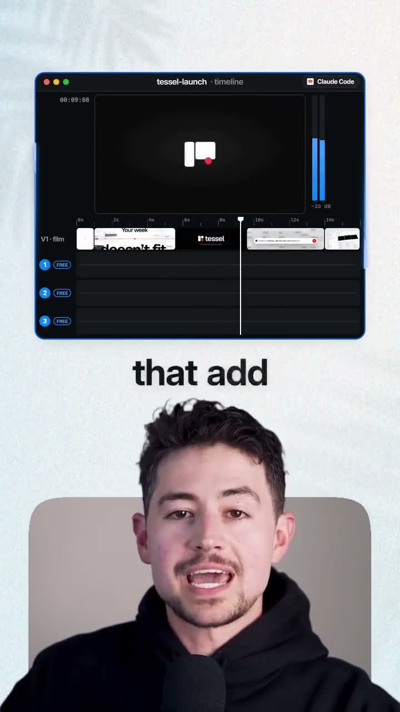

- **Timestamp & New Editing Style**:
  - **Timestamp**: Unknown [Internal timeline timecode: `00:09:08`, playhead at 9s].
  - **New Editing Style Introduced First**: 50/50 Split with timeline window displaying numbered tool badges (`1 FREE`, `2 FREE`, `3 FREE`) and bottom caption lockup.
- **Layout Type**: 50/50 Split.
- **Content Type, Main Focus & Caption Mode**:
  - **Content Type**: Object Centric + Person Centric (50/50 Split).
  - **Main Focus**: Video editing timeline showcasing three free AI tools alongside speaker explanation.
  - **Caption Mode**: Mode A: Talking Caption.
    - Actual Caption Words: `that add` in solid black sans bold font. Positioned at bottom of Layer A above speaker's head.
- **UI Card or Graph Type & Actual Values**:
  - **UI Card Type**: Dark app timeline window mockup floating in Layer A.
  - **Actual Values**:
    - Window title: `tessel-launch · timeline` (left) and `Claude Code` button/pill (right).
    - Preview canvas: Centred white rectangular logo icon with small red circle dot; blue audio meter bars reading `-29 dB`.
    - Timeline ruler: Timecode `00:09:08`, time markings `0s` to `14s`, vertical white playhead at `9s`.
    - Tracks: `V1 · film` with thumbnails, followed by three stacked tool tracks marked with blue pill badges: `1 FREE`, `2 FREE`, and `3 FREE`.
- **Two-Layer & Eye-Line Crop Check**:
  - **Layer A (Top 0-50%)**: Pale textured backdrop holding dark timeline window and `that add` caption.
  - **Layer B (Bottom 50-100%)**: Clean person layer only. Rounded speaker card, dark hoodie, mic at bottom. No text overlays on face.
  - **Eye-Line Crop Check**:
    - Head top: ~54% frame height (clean headroom).
    - Eye line: ~64% frame height (strictly in 62%–65% band).
    - Chin: ~73% frame height (fully visible).
    - Cropped from eye line, NOT bottom 50% slice.
- **Brief Sound Cue**: Pop on tool badges appearance; click on playhead scrub; music low under voice.
- **Numbered Legend**:
  1. **Textured canvas (Layer A)**: Pale off-white textured background occupying top 50%.
  2. **Dark timeline window**: Window mockup with red/yellow/green dots, title "tessel-launch · timeline", and "Claude Code" button, centre Layer A.
  3. **Video preview & VU meter**: Animation preview with white logo shape and blue audio level bars at "-29 dB", top inside window.
  4. **Tool badges**: Three blue pills labeled `1 FREE`, `2 FREE`, and `3 FREE` on stacked audio/tool tracks, left inside window.
  5. **Playhead scrubber**: Vertical white playhead line positioned at 9s along timecode ruler reading "00:09:08", inside window.
  6. **Talking caption**: "that add" in black sans font, positioned in the gap above speaker's head, bottom of Layer A.
  7. **Person layer (Layer B)**: Speaker in rounded frame with eye line at ~64%, chin and mic intact, zero text over face.

---

### Frame 04: Terminal Typing Animation with Block Cursor

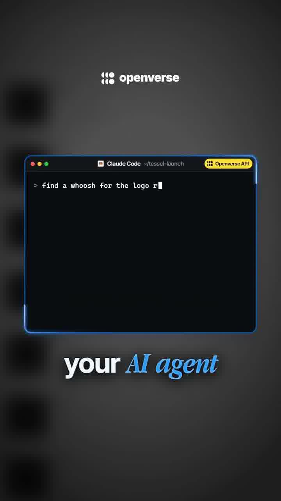

- **Timestamp & New Editing Style**:
  - **Timestamp**: Unknown.
  - **New Editing Style Introduced First**: 100% Full Canvas terminal typing animation with block cursor (camera tracks text writing), partner brand badge, and script italic gradient caption.
- **Layout Type**: 100% Full Canvas.
- **Content Type, Main Focus & Caption Mode**:
  - **Content Type**: Object Centric (Object + Text) / Terminal Typing Animation.
  - **Main Focus**: Terminal prompt actively typing a sound query with block cursor.
  - **Caption Mode**: Mode B: Statement Lockup / Bottom Key Phrase.
    - Actual Caption Words: `your AI agent` ("your" in bold white sans; "AI agent" in large bright blue script italic with soft blue glow and subtle gradient).
- **UI Card or Graph Type & Actual Values**:
  - **Top Brand Logo**: `openverse` in white sans with 6-circle brand mark icon.
  - **UI Card Type**: Dark terminal window with red, yellow, green window dots, title `Claude Code ~/tessel-launch`, and top-right yellow badge `Openverse API`.
  - **Actual Values**: Terminal prompt line actively typing:
    `> find a whoosh for the logo r█` (solid white rectangular typing block cursor).
- **Two-Layer & Eye-Line Crop Check**: N/A (100% Full Canvas layout).
- **Brief Sound Cue**: Rapid keyboard click/tick SFX tracking letter-by-letter typing; riser before reveal; music low under voice.
- **Numbered Legend**:
  1. **Brand header**: "openverse" logo and icon in clean white, positioned top centre of canvas.
  2. **Terminal window card**: Dark rounded window mockup with macOS dots and title "Claude Code ~/tessel-launch", centre.
  3. **Partner badge**: Yellow rounded pill badge in top-right of terminal reading "Openverse API".
  4. **Typing prompt with block cursor**: Monospace prompt `> find a whoosh for the logo r` followed by a solid white block cursor `█` indicating active character generation, inside terminal.
  5. **Subtle border framing**: Dark gradient background with faint filmstrip perforations along the left edge.
  6. **Key phrase caption**: "your" in white sans followed by "AI agent" in large bright blue script italic with soft glow, bottom centre.

---

### Frame 05: Gigantic Metric Number Lockup & API Response List

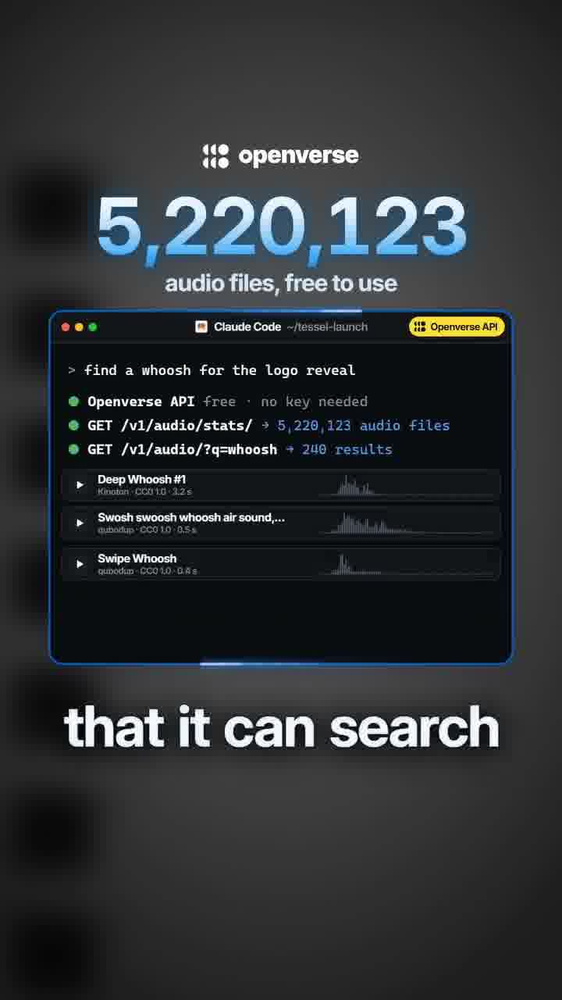

- **Timestamp & New Editing Style**:
  - **Timestamp**: Unknown.
  - **New Editing Style Introduced First**: Gigantic metric number lockup (`5,220,123`), API endpoint response log, and playable sound result list cards.
- **Layout Type**: 100% Full Canvas.
- **Content Type, Main Focus & Caption Mode**:
  - **Content Type**: Text Centric / Graphic Centric (Number Lockup + API Result List).
  - **Main Focus**: Massive audio file inventory metric (`5,220,123 audio files, free to use`) and terminal search results.
  - **Caption Mode**: Mode B: Statement Lockup.
    - Actual Giant Lockup Words: `5,220,123` / `audio files, free to use`
    - Actual Bottom Caption Words: `that it can search` in bold white sans.
- **UI Card or Graph Type & Actual Values**:
  - **Number Lockup**: Huge numbers `5,220,123` in bold white/ice-blue sans with subtle gradient, followed by subtitle `audio files, free to use`.
  - **UI Card Type**: Dark terminal window with yellow `Openverse API` badge.
  - **Actual Values inside Terminal**:
    ```text
    > find a whoosh for the logo reveal
    ● Openverse API free · no key needed [green dot]
    ● GET /v1/audio/stats/ -> 5,220,123 audio files [green dot, blue arrow]
    ● GET /v1/audio/?q=whoosh -> 240 results [green dot, blue arrow]
    ```
    Three audio list rows with play buttons, waveforms, and metadata:
    1. `Deep Whoosh #1` (Kiroton · CC0 1.0 · 3.2s)
    2. `Swosh swoosh whoosh air sound,...` (qubodup · CC0 1.0 · 0.5s)
    3. `Swipe Whoosh` (qubodup · CC0 1.0 · 0.4s)
- **Two-Layer & Eye-Line Crop Check**: N/A (100% Full Canvas layout).
- **Brief Sound Cue**: Hit on gigantic number reveal; whoosh on list item cascade; click on play buttons; music low under voice.
- **Numbered Legend**:
  1. **Brand logotype**: "openverse" with icon in white, top centre.
  2. **Gigantic metric number**: "5,220,123" in massive ice-blue bold sans typography, upper centre.
  3. **Metric subtitle**: "audio files, free to use" in crisp white sans text beneath number lockup.
  4. **Terminal window**: Dark window mockup with yellow "Openverse API" badge and API terminal log lines, mid-frame.
  5. **Audio search results**: Three stacked dark rows displaying track titles (`Deep Whoosh #1`, `Swosh swoosh...`, `Swipe Whoosh`), play icons, and waveform previews, lower inside terminal.
  6. **Bottom statement caption**: "that it can search" in large bold white sans font, bottom centre.

---

### Frame 06: Plain White Canvas Chapter Lockup ("Tool Number Two")

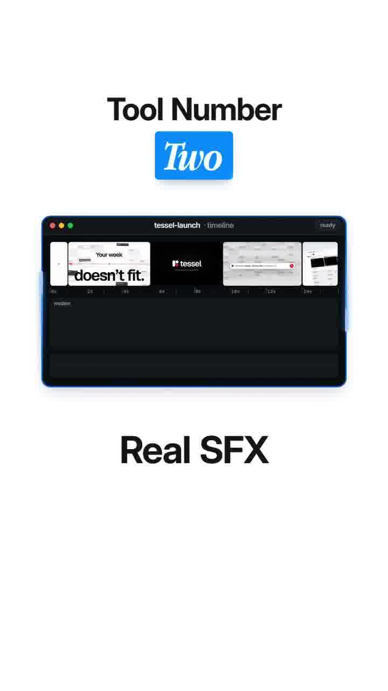

- **Timestamp & New Editing Style**:
  - **Timestamp**: Unknown.
  - **New Editing Style Introduced First**: Plain white solid canvas variant (Section 4 background 2), chapter header with script pill badge (`Two`), and bold statement lockup (`Real SFX`).
- **Layout Type**: 100% Full Canvas.
- **Content Type, Main Focus & Caption Mode**:
  - **Content Type**: Text Centric (Text + Object) on Plain White Canvas.
  - **Main Focus**: Minimalist chapter announcement for Tool Number Two.
  - **Caption Mode**: Mode B: Statement Lockup.
    - Top Lockup Words: `Tool Number` (black sans bold) / `Two` (white script italic inside bright blue rounded card).
    - Bottom Lockup Words: `Real SFX` (large black sans bold).
- **UI Card or Graph Type & Actual Values**:
  - **UI Card 1**: Bright blue rounded rectangular pill card with white script italic text `Two`.
  - **UI Card 2**: Dark timeline window mockup centered on white canvas: title `tessel-launch · timeline`, right label `ready`, 3 window dots (red/yellow/green), showing sequence clips.
- **Two-Layer & Eye-Line Crop Check**: N/A (100% Full Canvas layout).
- **Brief Sound Cue**: Hit on "Tool Number Two" appearance; pop on blue badge; music low under voice.
- **Numbered Legend**:
  1. **Plain white canvas**: Solid white background (Background Variant 2 from Section 4) with generous negative space.
  2. **Section label**: "Tool Number" in dark charcoal/black bold sans font, top centre.
  3. **Number badge**: Bright blue rounded rectangle containing "Two" in white script italic, top centre.
  4. **Centred app window**: Dark macOS timeline window labeled "tessel-launch · timeline" and "ready", dead centre.
  5. **Bottom statement**: "Real SFX" in large heavy black sans font, bottom centre.

---

### Frame 07: Split Detailed Timeline, Audio Transient Graph & Filmstrip

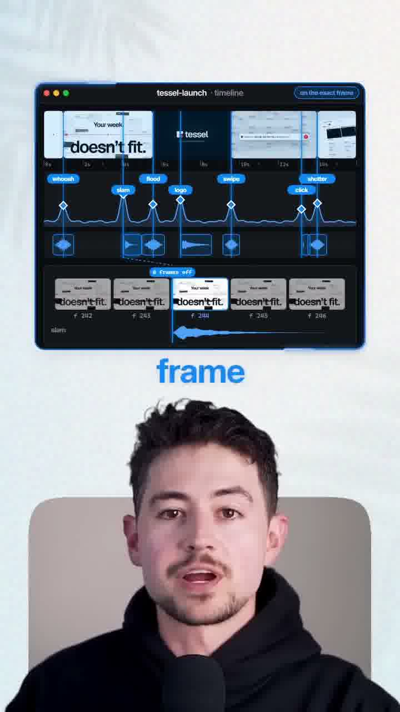

- **Timestamp & New Editing Style**:
  - **Timestamp**: Unknown [Internal timeline timecode: Frame 244 / `f 244`, status badge: `on the exact frame`].
  - **New Editing Style Introduced First**: 50/50 Split with transient peak marker graph, frame-by-frame filmstrip thumbnails (`f 242` to `f 246`), and frame offset tag (`-8 frames off`).
- **Layout Type**: 50/50 Split.
- **Content Type, Main Focus & Caption Mode**:
  - **Content Type**: Graphic Centric / Object Centric (Detailed Timeline Transient Graph) + Person Centric.
  - **Main Focus**: Frame-accurate sound sync graph aligning audio hits to exact video cuts.
  - **Caption Mode**: Mode A: Talking Caption.
    - Actual Caption Words: `frame` in large bright cyan-blue sans bold font. Positioned in clearance gap directly above speaker's head.
- **UI Card or Graph Type & Actual Values**:
  - **UI Card Type**: Dark macOS window `tessel-launch · timeline` with blue badge `on the exact frame`.
  - **Actual Values**:
    - Upper video thumbnails: `Your week doesn't fit.`, `tessel`.
    - Audio transient graph line: Blue line graph with sharp peaks and diamond markers paired with blue pill labels: `whoosh`, `slam`, `flood`, `logo`, `swipe`, `click`, `shutter`.
    - Offset pill: Blue badge `-8 frames off`.
    - Filmstrip track: 5 sequential video frame boxes labeled `doesn't fit.` with frame counts: `f 242`, `f 243`, `f 244`, `f 245`, `f 246`, with blue audio waveform below labeled `slam`.
- **Two-Layer & Eye-Line Crop Check**:
  - **Layer A (Top 0-50%)**: Pale textured backdrop holding complex timeline mockup and `frame` caption at bottom of layer.
  - **Layer B (Bottom 50-100%)**: Clean person layer only. Rounded speaker box, dark hoodie, mic at bottom. No text overlays on face.
  - **Eye-Line Crop Check**:
    - Head top: ~54% frame height (clean headroom).
    - Eye line: ~64% frame height (strictly in 62%–65% band).
    - Chin: ~73% frame height (fully visible).
    - Cropped from eye line with small headroom, NOT bottom 50% slice.
- **Brief Sound Cue**: Sharp click/pop on diamond peak markers; whoosh on filmstrip scrub; music low under voice.
- **Numbered Legend**:
  1. **Textured canvas (Layer A)**: Pale off-white textured background occupying top 50%.
  2. **Window header & badge**: Dark window title "tessel-launch · timeline" with blue status pill reading "on the exact frame", top of window.
  3. **Audio transient line graph**: Glowing blue line with peak diamonds and blue pill tags (`whoosh`, `slam`, `flood`, `logo`, `swipe`, `click`, `shutter`), mid window.
  4. **Frame offset badge**: Blue pill flag indicating "-8 frames off", mid-lower window.
  5. **Frame-by-frame filmstrip**: 5 individual frame thumbnails displaying frame numbers `f 242`, `f 243`, `f 244`, `f 245`, `f 246` over a "slam" waveform, bottom of window.
  6. **Key talking caption**: "frame" in vibrant cyan-blue bold sans font, positioned in the clearance zone between window and head, centre.
  7. **Person layer (Layer B)**: Speaker in rounded frame with calibrated eye line at ~64%, shoulders filling bottom, face completely clear.

---

### Frame 08: Branded Product Card on Plain White Canvas ("Earshot 0.3")

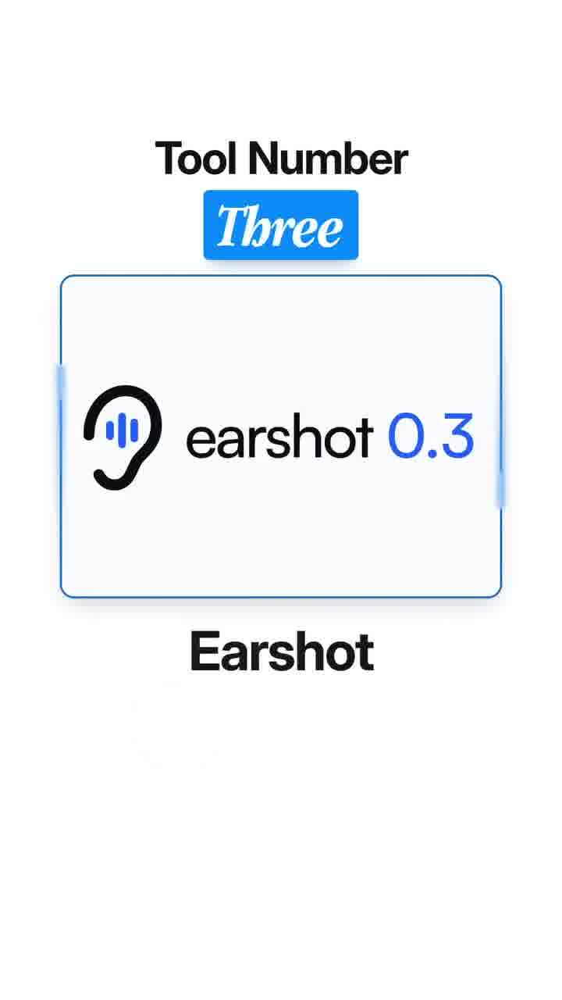

- **Timestamp & New Editing Style**:
  - **Timestamp**: Unknown.
  - **New Editing Style Introduced First**: Standalone logo/product card with branded icon and subtle border glow on plain white canvas.
- **Layout Type**: 100% Full Canvas.
- **Content Type, Main Focus & Caption Mode**:
  - **Content Type**: Object Centric (Logo or Product Card) on Plain White Canvas.
  - **Main Focus**: Product card reveal for "earshot 0.3".
  - **Caption Mode**: Mode B: Statement Lockup.
    - Top Lockup Words: `Tool Number` (black sans bold) / `Three` (white script italic inside bright blue rounded card).
    - Bottom Statement Word: `Earshot` (large black sans bold).
- **UI Card or Graph Type & Actual Values**:
  - **UI Card 1**: Bright blue rounded rectangle pill card with white script italic `Three`.
  - **UI Card 2**: White rounded rectangular card with subtle blue perimeter stroke and soft shadow. Inside card: black ear outline icon with three blue vertical audio bars inside, followed by text `earshot 0.3` ("earshot" in black sans, "0.3" in blue sans).
- **Two-Layer & Eye-Line Crop Check**: N/A (100% Full Canvas layout).
- **Brief Sound Cue**: Hit on "Tool Number Three" reveal; pop on Earshot card entrance; music low under voice.
- **Numbered Legend**:
  1. **Plain white canvas**: Solid white background (Background Variant 2) providing high contrast and generous whitespace.
  2. **Section label**: "Tool Number" in black bold sans-serif font, top centre.
  3. **Chapter pill badge**: Bright blue rounded rectangle containing "Three" in white script italic font, top centre.
  4. **Product card container**: White rounded rectangle card with delicate blue border glow and soft drop shadow, dead centre.
  5. **Earshot logo icon**: Black ear contour icon enclosing three vertical blue audio bars, inside card left.
  6. **Product title & version**: "earshot" in black sans alongside "0.3" in accent blue sans, inside card right.
  7. **Bottom statement caption**: "Earshot" in heavy black sans font, bottom centre.

---

### Frame 09: 3x3 Sound-Pad Matrix & CLI Terminal Execution Card

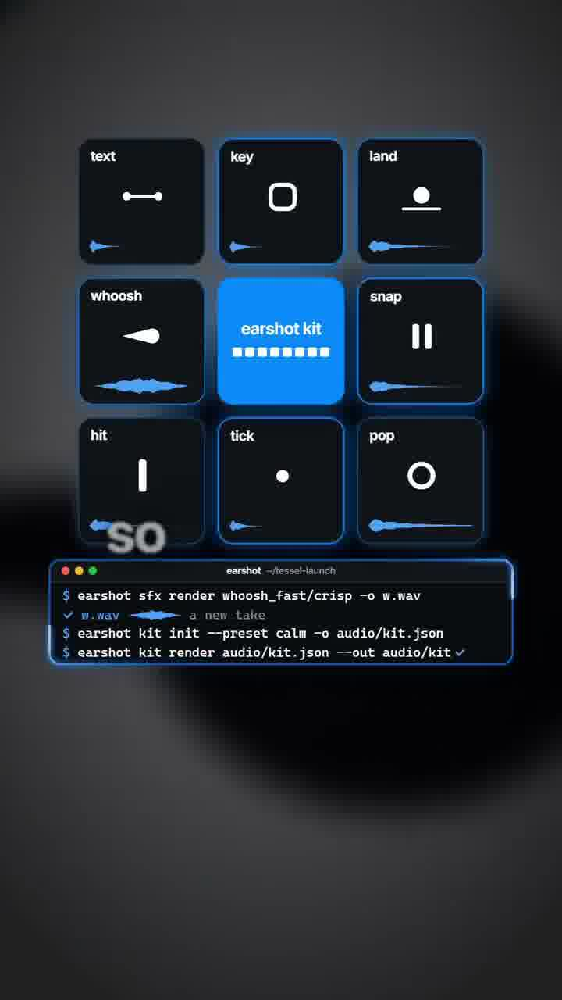

- **Timestamp & New Editing Style**:
  - **Timestamp**: Unknown.
  - **New Editing Style Introduced First**: 3x3 interactive sound-pad matrix (9 glowing buttons with icons and waveforms) combined with CLI terminal execution card.
- **Layout Type**: 100% Full Canvas.
- **Content Type, Main Focus & Caption Mode**:
  - **Content Type**: Object Centric / Graphic Centric (Sound Pad Grid + CLI Terminal).
  - **Main Focus**: 9-pad sound effects kit grid and terminal commands generating audio assets.
  - **Caption Mode**: Mode B: Statement Lockup (or corner focal caption `so`).
    - Actual Words: `so` in white bold sans.
- **UI Card or Graph Type & Actual Values**:
  - **UI Card 1 (3x3 Sound Pad Matrix)**:
    - Row 1: `text` (white horizontal bar, blue waveform); `key` (white squircle, blue waveform); `land` (white circle over line, blue waveform).
    - Row 2: `whoosh` (white teardrop/wedge, blue waveform); `earshot kit` (centre bright blue pad with white square dots); `snap` (white pause/bars, blue waveform).
    - Row 3: `hit` (white vertical bar, blue waveform); `tick` (white dot, blue waveform); `pop` (white ring, blue waveform).
  - **UI Card 2 (Terminal Window)**: Dark window with red, yellow, green dots, title `earshot ~/tessel-launch`:
    ```bash
    $ earshot sfx render whoosh_fast/crisp -o w.wav
    ✓ w.wav a new take [waveform graphic]
    $ earshot kit init --preset calm -o audio/kit.json
    $ earshot kit render audio/kit.json --out audio/kit ✓
    ```
- **Two-Layer & Eye-Line Crop Check**: N/A (100% Full Canvas layout).
- **Brief Sound Cue**: Pop/tick on sound pad trigger; click on terminal command execution; whoosh SFX; music low under voice.
- **Numbered Legend**:
  1. **Dark ambient canvas**: Deep charcoal background with soft blue atmospheric glow.
  2. **3x3 Sound pad grid**: Nine rounded dark glass buttons with glowing blue outlines arranged in a 3x3 array, upper centre.
  3. **Sound category pads**: Eight outer pads labeled `text`, `key`, `land`, `whoosh`, `snap`, `hit`, `tick`, and `pop`, each featuring a white minimalist icon and blue waveform snippet.
  4. **Centre master pad**: Solid bright blue tile labeled `earshot kit` with a row of white square indicator blocks, centre of 3x3 grid.
  5. **Terminal CLI card**: Dark window mockup with macOS dots and title "earshot ~/tessel-launch", lower centre.
  6. **CLI command lines**: Executable bash commands (`earshot sfx render...`, `earshot kit init...`, `earshot kit render...`) with checkmarks and waveform render outputs, inside terminal.
  7. **Supporting caption**: "so" in bold white sans font, positioned at lower left.

---

### Frame 10: Two-Tone High-Contrast Ending CTA on Full Speaker

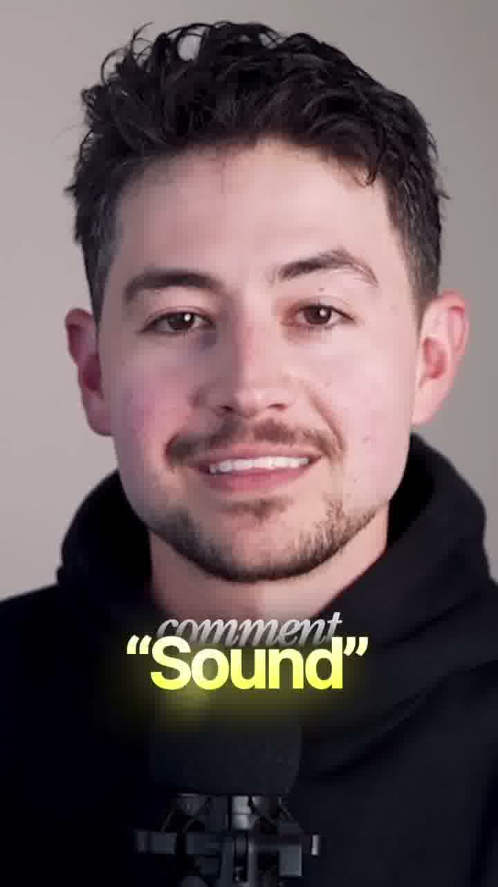

- **Timestamp & New Editing Style**:
  - **Timestamp**: Unknown (Ending CTA scene per MD Section 4 line 240, Section 5 line 314).
  - **New Editing Style Introduced First**: High-contrast two-tone Call-to-Action (CTA) lockup (white script italic "comment" paired with bright lime-yellow bold sans '"Sound"') on close-up Full Speaker.
- **Layout Type**: Full Speaker.
- **Content Type, Main Focus & Caption Mode**:
  - **Content Type**: Person Centric (Person in Center / Ending CTA).
  - **Main Focus**: Main speaker delivering final direct call to action to the audience.
  - **Caption Mode**: Mode A: Talking Caption / CTA Lockup.
    - Actual Caption Words: `comment "Sound"` ("comment" in white script italic; `"Sound"` in bright yellow/lime-green bold sans font with drop shadow). Positioned lower thirds over collar/chest/mic.
- **UI Card or Graph Type & Actual Values**: None (clean Full Speaker, no UI card; ends directly on speaker with zero outro animation per MD Section 4 line 240).
- **Two-Layer & Eye-Line Crop Check**: N/A (Full Speaker layout).
- **Brief Sound Cue**: Hit on final CTA keyword '"Sound"'; riser trailing into silence; no outro music after CTA.
- **Numbered Legend**:
  1. **Main speaker**: Close-up talking head smiling, centred against light neutral studio background, microphone at lower border.
  2. **Lower-third CTA zone**: Text placed over collar/chest area, never obstructing face or eyes.
  3. **Script call-to-action prompt**: "comment" in white script italic typography, lower centre.
  4. **High-contrast keyword**: '"Sound"' in vibrant lime-yellow bold sans-serif font enclosed in quotation marks with drop shadow, lower centre.
  5. **Minimal ending framing**: Direct cut without outro cards, logos, or extra animations following the CTA line.

---
